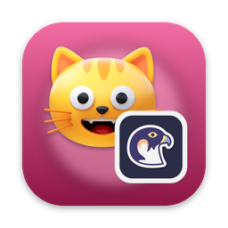
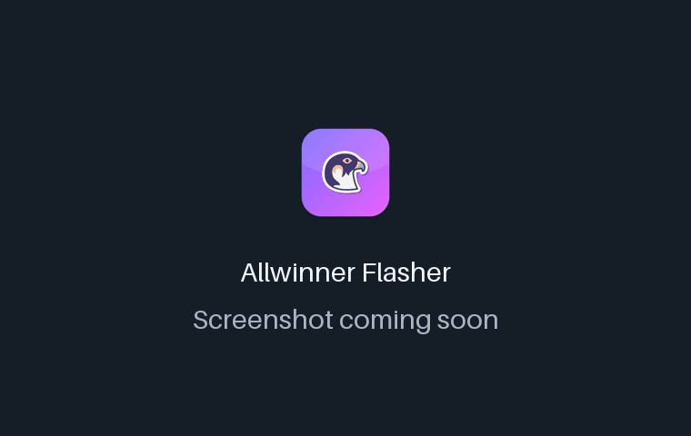
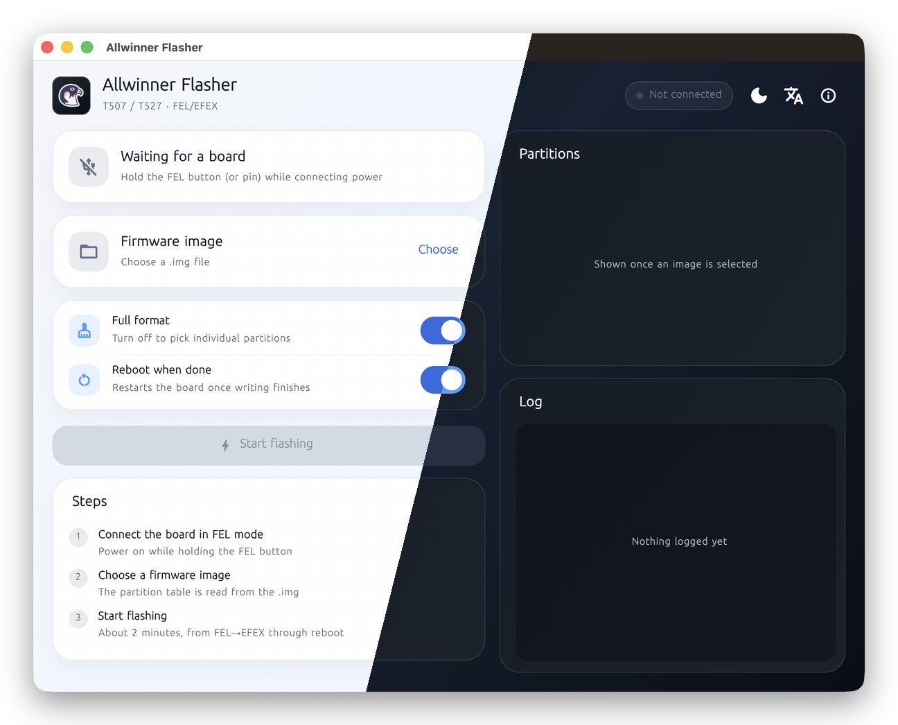
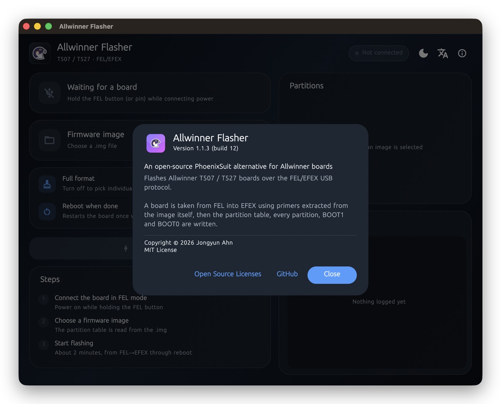

<!-- From jejezz/application-release-templates common/tool/readme @ conventions-v1.
     tool/readme/init_readme.py가 만든 파일입니다 — conventions/readme-guide.md 참고.
     {{TODO: …}}를 모두 채우십시오. 하나라도 남아 있으면 tool/readme/check_readme.py가 실패합니다. -->

<p align="center">
  
</p>

<h1 align="center">Hawk Flasher</h1>

<p align="center">
  AllWinner CPU 보드를 FEL/EFEX USB로 플래싱하는 무료 오픈소스 <b>PhoenixSuit 대체 도구</b> — macOS, Windows, Linux에서 동작합니다.
</p>

<p align="center">
  <a href="https://github.com/jejezz/allwinner-flashing-tool-macos/releases/latest"></a>
  <a href="https://github.com/jejezz/allwinner-flashing-tool-macos/releases"></a>
  
  
  <a href="LICENSE"></a>
</p>

<p align="center">
  <a href="README.md">English</a> · <b>한국어</b>
</p>

<p align="center">
  
</p>

## 기능

- **FEL부터 재부팅까지 한 번에** — 이미지에서 꺼낸 프라이머로 보드를 FEL에서 EFEX로 넘긴 뒤 파티션 테이블, 각 파티션, BOOT1, BOOT0을 기록합니다 (1.1 GB 이미지 기준 약 1분 40초)
- **남길 파티션 고르기** — 전체 포맷을 끄고 `userdata` 같은 파티션의 체크를 해제하면 그대로 남습니다. 확인 창에 남는 파티션이 그대로 보입니다
- **작업대 건너편에서도 보이는 진행 상황** — 전체·파티션별 진행률과 실시간 로그, 기록 중 보라·완료 초록·실패 빨강으로 바뀌는 창
- **밑에는 CLI** — 앱이 하는 일을 `aw-tool` 하나로 모두 할 수 있고, 스크립트용 `--json` 이벤트를 냅니다
- **라이트·다크, 한국어·English** — 시스템 설정을 따르거나 툴바에서 고를 수 있습니다

<p align="center">
  
  
</p>

## 설치

[**Releases**](https://github.com/jejezz/allwinner-flashing-tool-macos/releases/latest)에서 받습니다.

| OS | 파일 |
|---|---|
| macOS 12.0 이상 (Apple Silicon) | `HawkFlasher-<버전>-macos-arm64.dmg` — 열어서 앱을 Applications 폴더로 끌어다 놓으세요 |
| Windows 10/11 (x64) | `HawkFlasher-<버전>-windows-x64-setup.exe` |
| Linux (x64) | `HawkFlasher-<버전>-linux-x64.tar.gz` — 압축을 풀고 `./install.sh` 실행 (`--remove`로 제거) |

**Windows:** 설치 프로그램에 아직 코드 서명이 없어서 SmartScreen이 "Windows의 PC 보호" 창을 띄웁니다. **추가 정보 → 실행**을 누르세요. 처음 플래싱하기 전에 [Zadig](https://zadig.akeo.ie/)로 보드(FEL 모드, VID `1f3a` / PID `efe8`)를 **WinUSB** 드라이버에 한 번 연결해야 앱이 보드를 찾습니다. 앱 머리글의 문제 해결 버튼에 순서가 있습니다.

**Linux:** `libusb-1.0-0`과, `sudo` 없이 쓰기 위한 udev 규칙이 필요합니다 — [USB 드라이버](docs/aw-tool.md#usb-드라이버) 참고.

## 동작 방식

FEL/EFEX 프로토콜은 Rust(`aw-tool`, libusb 사용)로 직접 구현했고, Flutter 앱은 이를 **서브프로세스**로 실행해 NDJSON 이벤트를 읽습니다. USB 전송은 실제로 멈출 수 있어서(잘못된 명령 하나로 보드가 전송 타임아웃까지 묶인 적이 있습니다) 별도 프로세스로 두면 그런 경우도 깔끔하게 종료할 수 있고, 중단 버튼도 같은 방식으로 동작합니다. 조사 과정은 [docs/T527-T507-FEL-EFEX-기술조사.md](docs/T527-T507-FEL-EFEX-기술조사.md)에 있습니다.

## 개발

Flutter 앱은 `gui/`에, Rust CLI는 저장소 루트에 있습니다. 저장소에서 실행하면 앱이 `target/release/aw-tool`을 알아서 찾습니다.

### 1. Rust 설치

```bash
# macOS/Linux
curl --proto '=https' --tlsv1.2 -sSf https://sh.rustup.rs | sh
# Windows
winget install Rustlang.Rustup
```

Windows에서는 Visual Studio Build Tools의 **"C++를 사용한 데스크톱 개발"** 워크로드도 필요합니다 — Rust MSVC 타겟과 libusb 소스 빌드에 쓰이는 `cl.exe`를 제공합니다. [rustup](https://rustup.rs)이 `~/.cargo/bin`(Windows는 `%USERPROFILE%\.cargo\bin`)을 `PATH`에 자동으로 추가하는데, 설치 후 **터미널을 새로 열어야** 반영됩니다 — `cargo --version`으로 확인하세요.

### 2. 빌드·실행

```bash
cargo build --release
cd gui
flutter pub get
flutter run -d macos   # 또는 -d windows / -d linux
```

libusb도 필요합니다 (macOS는 `brew install libusb`, Windows는 `--features vendored`로 소스에서 자동 빌드되므로 별도 설치가 필요 없습니다). CLI 사용법, 플랫폼별 빌드 스크립트, 실기 검증 현황, 소스 구성은 [docs/aw-tool.md](docs/aw-tool.md)에 있습니다. 릴리스 CI: [docs/release-ci.md](docs/release-ci.md).

### 3. Windows: 보드를 WinUSB로 바인딩

보드는 FEL·EFEX 모두 `1f3a:efe8`로 열거됩니다. 장치 관리자에 정상적인 장치로 보여도, 그 인터페이스가 **WinUSB**에 바인딩돼 있지 않으면 앱이 아예 열지 못합니다 — [Zadig](https://zadig.akeo.ie/)로 바인딩하는 정확한 순서는 [USB 드라이버](docs/aw-tool.md#usb-드라이버)를 참고하세요. 드라이버가 아예 없는 **새 장치**를 바인딩하는 건 관리자 권한이 필요 없지만, **이미 설치된 드라이버를 교체**하는 건 관리자 권한이 필요합니다 — 장치에 이미 드라이버가 붙어 있다면 Zadig을 관리자 권한으로 실행하세요.

### 4. Windows: 충돌하는 벤더 드라이버 제거

이 PC에 PhoenixSuit 등 다른 Allwinner 툴을 설치한 적이 있다면, `1f3a:efe8`용 자체 드라이버가 이미 깔려 있을 수 있습니다. Windows는 보드가 재열거될 때마다(특히 플래싱 중 FEL→EFEX로 넘어가는 순간) WinUSB 대신 그 드라이버를 조용히 다시 골라버릴 수 있는데, 그러면 앱이 FEL은 잘 찾는데 EFEX를 기다리다 타임아웃되는 증상으로 나타납니다 — 그동안 장치 관리자에는 계속 정상으로 보입니다. **장치 관리자 → 장치 → 속성 → 드라이버 → 드라이버 세부 정보**에서 파일명이 `winusb.sys`가 아니면 이게 원인입니다.

해결: 장치 관리자 → 장치 → **디바이스 제거** → **"이 장치의 드라이버 소프트웨어를 삭제합니다"** 체크(관리자 권한 필요) → 보드를 FEL 모드로 다시 연결 → Zadig으로 WinUSB 재바인딩. 자세한 내용: [USB 드라이버 — 기존에 설치된 벤더 드라이버](docs/aw-tool.md#usb-드라이버).

릴리스: `scripts/bump-version.sh patch` → 병합 → `vX.Y.Z` 태그. CI가 모든 플랫폼을 빌드해서 올립니다. 규칙: [application-release-templates/conventions](https://github.com/jejezz/application-release-templates/tree/main/conventions).

## 크레딧

- 글꼴: [서울남산체](https://www.seoul.go.kr/seoul/font.do) (서울특별시)
- 아이콘: [Icons8](https://icons8.com)
- USB: [libusb](https://libusb.info) (LGPL-2.1)

## 라이선스

[MIT](LICENSE) © 2026 Jongyun Ahn
